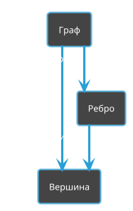
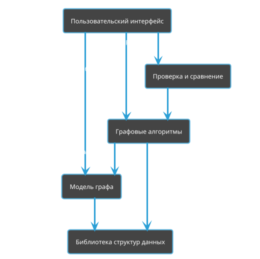

## I. Постановка задачи

#### 1. Что разрабатывается

**Цель работы:** разработка программы для создания и изменения ориентированных и неориентированных графов и выполнения графовых алгоритмов
#### 2. Зачем нужна программа

Программа предназначена для представления связей между объектами, исследования свойств графов и решения задач поиска, упорядочивания и оптимизации
#### 3. Где применяется

Моделирование транспортных и коммуникационных сетей, анализ зависимостей между задачами (объектами), поиск маршрутов, планирование процессов и исследование графовых алгоритмов

## II. Сущности прикладной задачи

### 1. Основные сущности

-  **Граф** - совокупность вершин и ребер, описывающая связи между объектами
-  **Вершина** - отдельный объект графа, имеющий уникальный идентификатор и связанные с ним данные
-  **Ребро** - связь между двумя вершинами. Может обладать или не обладать весом. Между парой вершин может быть несколько ребер
### 2. Связи между сущностями

-  Граф содержит множество вершин и соединяющих их ребер.
-  Каждое ребро связывает ровно две вершины одного графа
-  В ориентированном графе ребро задает направление перехода, в неориентированном допускает переход в обе стороны
-  Между одной парой вершин могут существовать несколько ребер с различными или одинаковыми характеристиками
-  Ребро может соединять вершину с самой собой, образуя петлю
-  Характеристики ребер могут использоваться при вычислении стоимости пути либо для формирования других результатов, например строки из символов

### 3. Схема связей

## III. Архитектура

### 1. Основные компоненты

#### 1.1. Компонент модели графа

Отвечает за хранение и изменение графа, доступ к вершинам и ребрам, получение связей и поддержание целостности структуры. Информации о связях хранятся здесь
Поддерживает ориентированные и неориентированные графы, петли, параллельные ребра и различные типы характеристик
#### 1.2. Компонент графовых алгоритмов

Предоставляет алгоритмы обхода, поиска кратчайших путей, топологического упорядочения, построения остовного древа
Требования к направленности графа, характеристикам ребер и допустимым значениям определяются отдельно для каждого алгоритма

#### 1.3. Компонент проверки и сравнения

Обеспечивает проверку корректности алгоритмов, измерение времени выполнения и сравнение алгоритмов на одинаковых исходных данных.

Предусматривает формирование результатов измерений для последующего анализа.

#### 1.4. Компонент библиотечных структур данных

Предоставляет последовательности, AVL-словари и другие структуры, необходимые для хранения графа и выполнения алгоритмов
Используются структуры данных, разработанные в предыдущих лабораторных работах

#### 1.5. Компонент пользовательского интерфейса

Обеспечивает создание и изменение графов, ввод исходных данных, выбор алгоритмов, настройку параметров, запуск вычислений и просмотр результатов.

### 2. Взаимодействие компонентов

Пользовательский интерфейс передает команды модели графа и компоненту алгоритмов.

Модель графа выполняет операции над вершинами и ребрами, используя библиотеку структур данных.

Алгоритмы получают информацию о графе через предоставленные моделью операции и возвращают результаты вычислений.

Компонент проверки запускает алгоритмы на подготовленных графах, измеряет время их выполнения и формирует данные для сравнения.

### 3. Схема архитектуры

### 4. Основные структуры данных и решения

#### 4.1. Модель графа

Для хранения графа используются два словаря:
-  **Словарь вершин** - устанавливает соответствие между уникальными идентификаторами вершин и их данными.
-  **Словарь ребер** - устанавливает соответствие между парой вершин и последовательностью характеристик ребер между ними.

Для неориентированного графа порядок вершин в паре не имеет значения, в нем ребро хранится однократно независимо от направления обращения к нему.

#### 4.2. Идентификация элементов

Каждая вершина обладает уникальным идентификатором
Идентификатор может задаваться пользователем либо автоматически формироваться для поддерживаемых целочисленных типов
Отдельное ребро определяется парой соединяемых вершин

#### 4.3. Характеристики ребер

Граф допускает различные типы характеристик ребер, включая числа, символы, строки и пользовательские типы данных

Способы обработки характеристик определяются алгоритмами и не ограничивают общую модель графа

В частности, при обработке пути характеристики отдельных ребер могут объединяться в общий результат: суммарную стоимость, строку или другую величину..

### 5. Основные алгоритмы

#### 5.1. Обход в ширину (BFS)

Последовательно исследует вершины по мере увеличения числа переходов от начальной вершины
Использует очередь и учет посещенных вершин
Позволяет определить достижимые вершины и порядок их обхода

#### 5.2. Обход в глубину (DFS)

Исследует граф, последовательно переходя к еще не посещенным вершинам и возвращаясь при невозможности дальнейшего продвижения
Используется для исследования связности и структуры графа.

#### 5.3. Алгоритм Дейкстры

Находит кратчайшие расстояния от заданной вершины до остальных достижимых вершин.
Основан на последовательном выборе вершины с наименьшей текущей стоимостью пути и обновлении расстояний до соседей.
Применяется при неотрицательных числовых весах

#### 5.4. Алгоритм Беллмана-Форда

Находит кратчайшие расстояния от заданной вершины путем последовательного улучшения оценок расстояний
Допускает отрицательные веса и позволяет обнаруживать достижимые отрицательные циклы
При наличии такого цикла корректные конечные кратчайшие расстояния до затронутых вершин отсутствуют.

#### 5.5. Топологическая сортировка

Строит линейный порядок вершин ориентированного ациклического графа, при котором начало каждого ребра располагается раньше его конца
Используется для упорядочивания зависимых действий
При наличии направленного цикла топологический порядок не существует

#### 5.6. Алгоритм Краскала

Строит остов неориентированного взвешенного графа.
Последовательно рассматривает ребра в порядке возрастания веса и добавляет те, которые не образуют цикл

#### 5.7. Жадная раскраска (?)

Последовательно назначает вершинам цвета, исключая цвета уже обработанных соседних вершин.

Обеспечивает допустимую раскраску графа без петель, но не гарантирует минимальное количество цветов.

## IV. Функциональные требования

### 1. Работа с графом

-  Создание ориентированного или неориентированного графа
-  Добавление и удаление вершин
-  Добавление вершин с явным идентификатором
-  Автоматическое создание идентификаторов для поддерживаемых целочисленных типов
-  Изменение данных существующих вершин
-  Добавление и удаление ребер
-  Изменение характеристик существующих ребер.
-  Поддержка петель и параллельных ребер.
-  Удаление всех ребер, связанных с удаляемой вершиной.
-  Получение вершин, ребер и связей между ними.
-  Проверка существования вершины или ребра.
-  Получение количества вершин и ребер.

### 2. Выполнение алгоритмов

-  Проверка применимости алгоритма к заданному графу.
-  Выполнение вычислений и отображение результатов.

### 3. Обработка ошибок
-  Проверка корректности входных данных.
-  Проверка графа на соответствие требованиям алгоритма

## V. Нефункциональные требования

### 1. Общность

- Модель графа допускает различные типы идентификаторов, данных вершин и характеристик ребер
- Алгоритмы предъявляют только необходимые для их работы ограничения на типы данных
### 2. Эффективность

Для оценки сложности используются обозначения:

-  `V` — количество вершин
- `E` — количество ребер, включая параллельные
- `P` — количество различных пар соединенных вершин
- `d` — количество исходящих ребер заданной вершины
- `k` — количество параллельных ребер между выбранной парой вершин

| Операция                            | Асимптотическая сложность |
| ----------------------------------- | ------------------------- |
| Поиск вершины                       | O(log(V))                 |
| Проверка существования ребра        | O(log(P))                 |
| Добавление вершины                  | O(log(V))                 |
| Добавление ребра                    | O(log(P))                 |
| Получение исходящих ребер           | O(P + d)                  |
| Удаление одного параллельного ребра | O(log(P) + k)             |
| Удаление вершины                    | O(log(V) + E)             |
| Объем хранения графа                | O(V + E)                  |

